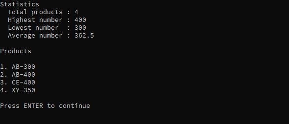

# Inventory Management System

A C# console application for managing a list of products. It was built for
**Weekly Mini Project 1: Product List Manager** and implements **Level 4**
(levels 1 to 3 are part of it). Everything runs in a single console window, and
the product list is kept in memory.

## Features

| Menu option | What it does |
|---|---|
| **1. Add Product** | Adds a product after validating it. Input is trimmed and the name is stored in upper case. A product that already exists is rejected with `WARNING: Product already exists.` |
| **2. View Products** | Shows statistics (total products and the highest, lowest and average product number), followed by a numbered list sorted by name and then by number. |
| **3. Search Products** | Searches by product number (if the query is a whole number) or by product name (exact match, ignoring case). Results are listed sorted. |
| **4. Delete Products** | Lists the products, asks for the product to delete (for example `AB-300`), asks for confirmation (y/n) and removes it. Leaving the input empty goes back to the menu. |
| **5. Exit** | Closes the program. Typing `exit` (in any case, with or without spaces) does the same. |

Error messages are shown in red and success messages in green. The screen is
cleared every time the menu is displayed, and the latest message is shown above
the menu.

## Product format and validation

A product has the format `NAME-NUMBER`, for example `CE-400`, `XX-480` or `LABAN-231`.

- The left side must contain **letters only** (A to Z).
- The right side must contain **numbers only**, from **200 to 500** (inclusive).

| Problem | Message |
|---|---|
| Empty input | `ERROR: Input cannot be empty.` |
| No dash | `ERROR: Product must contain a dash (-).` |
| Left side is not letters only | `ERROR: The left side must contain letters only.` |
| Right side is not numbers only | `ERROR: The right side must contain numbers only.` |
| Number outside 200 to 500 | `ERROR: The numeric part must be between 200 and 500.` |

Examples: `CE400`, `XX3-480`, `-300`, `AB-300B` and `LABAN-100` are all rejected.

## Example screen

The View Products screen with four products:

```
Statistics

  Total products : 4
  Highest number : 400
  Lowest number  : 300
  Average number : 362.5

Products

1. AB-300
2. AB-400
3. CE-400
4. XY-350

Press ENTER to continue
```

The average uses the decimal separator of the computer's regional settings
(a comma on a Swedish system).

## Screenshot



## How to run

Requires the [.NET software development kit (SDK) 10](https://dotnet.microsoft.com/download).

From the repository root:

```
dotnet run --project Lexicon.InventoryManagementSystem
```

Or open `Lexicon.InventoryManagementSystem.slnx` in a recent version of Visual
Studio and press F5.

## Project structure

| File | Purpose |
|---|---|
| `Program.cs` | The menu loop, input helpers and the screens (add, view, search, delete) |
| `Product.cs` | The `Product` record and `Product.Parse`, which validates and creates a product |
| `Inventory.cs` | The collection of products: adding (without duplicates), removing and looking up |
| `Result.cs` | `Result` and `Result<T>`: a message and a success flag, and for `Result<T>` also a value |

## Design decisions

- **`Product` is an immutable record that normalizes itself.** The name is
  converted to upper case when the product is created, so two products are equal
  when they have the same name and number. Duplicate checks, lookups and
  removal all rely on that single definition of "the same product".
- **Validation is done step by step in `Product.Parse`** (empty, dash, left side,
  right side, range) instead of with one regular expression, so that each kind
  of mistake produces its own error message.
- **`Result` and `Result<T>` instead of `out` parameters or exceptions.** An
  action returns a message and a success flag, and the menu loop prints it. A
  failed `Parse` is simply passed up to the caller, and `Result<T>` carries the
  parsed product, so there is no need for a null check after a successful parse.
- **`Product.Parse` has a `validateRange` parameter.** Adding a product enforces
  the range 200 to 500. Deleting only checks the format, so a well-formed product
  outside the range is reported as "not found" instead of as a range error.
- **Sorting happens when products are displayed** (`OrderBy` and `ThenBy`), so
  the inventory itself stays simple. `PrintProducts` is shared by the view,
  search and delete screens, so they always list products the same way.
- **Small helpers avoid repetition:** `HandleInput` (reads and checks input),
  `HandleYesNo`, `WaitForEnter` and `PrintStatistics`.
- **One exit point:** option 5 and typing `exit` both leave the menu loop in the
  same place.

## Requirements covered

| Level | Requirement | Status |
|---|---|---|
| 1 | Enter products, store them in a list, display them | Done (products are displayed through View Products) |
| 2 | Trim input, `exit` in any case, sorted list | Done |
| 3 | Validation of `LETTERS-NUMBER` with the required messages | Done |
| 4 | Prevent duplicates, menu, search by name or number, delete, statistics | Done |
| 4 (bonus) | Save to `products.txt` or `products.json` | Not implemented |
| Extra | Red error messages, green success messages, regular expressions for validation | Done |

## Limitations

- Products are kept in memory only, so they are lost when the program exits.
- Name search is an exact match, not a partial one.
- The bonus (saving to a file) is not implemented.

## Use of AI assistance

I used Claude (an AI assistant from Anthropic) while working on this project, as
a tutor and code reviewer. It explained concepts, reviewed my code, found bugs
and suggested designs, and it also showed code examples in the conversation.
